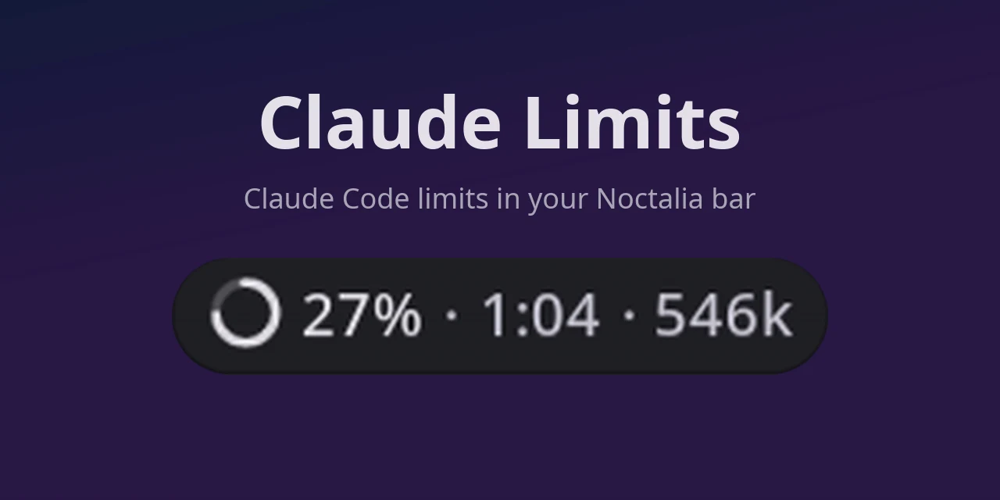
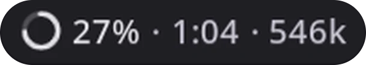
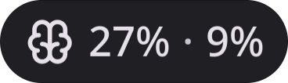
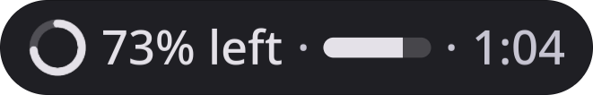

<div align="center">



<br>

[](https://github.com/noctalia-dev/noctalia)
[](https://docs.noctalia.dev/noctalia/plugins/development/)
[](https://github.com/YaLTeR/niri)
[](LICENSE)

**See how much of your Claude Code limit is left — right in your bar.**

[Quick start](#-quick-start) · [What the numbers mean](#-what-do-the-numbers-mean) · [Examples](#-examples) · [Customize](#-customize) · [Questions](#-questions)

</div>

---

## 🚀 Quick start

1. In Noctalia open **Settings → Plugins → Add source**, choose **git** and paste
   `https://github.com/Seo1323/noctalia-claude-usage`.
2. Switch on **Claude Limits** in the plugin list.
3. Add the **Claude Limits** widget to your bar.

You need `curl`, `jq` and Claude Code logged in on this machine.

<details>
<summary>Prefer the terminal?</summary>

```sh
noctalia msg plugins source add seo git https://github.com/Seo1323/noctalia-claude-usage
noctalia msg plugins enable seo/claude-usage
```

</details>

## 👀 What do the numbers mean?

<p align="center"></p>

| Part | Meaning |
| --- | --- |
| ◔ ring | How much of your limit is left — it empties as you use Claude Code. |
| **27%** | You have used 27% of your 5-hour limit. |
| **1:04** | In 1 hour 4 minutes the limit is full again. |
| **546k** | Claude has read and written about 546,000 tokens (pieces of text) in this window. |

Hover the widget for both limits; click it for graphs and a button that opens Claude Code.

## ✨ What you get

- **Your limits at a glance** — 5-hour and weekly usage, time to reset and tokens used.
- **Text, bar or ring** — numbers, a small progress bar, or a ring that empties as you go.
- **Quiet when you want** — show details always, only when usage is high, or on hover.
- **A panel on click** — both limits, token graphs, tokens per model, a Claude Code launcher and one-click resume
  of your latest sessions.
- **Make it yours** — 40+ options for icons, formats, colors and layout.
- **Speaks your language** — all 29 languages Noctalia supports.

## 📸 Examples

<table>
  <tr>
    <td align="center"><br><sub><b>Default</b></sub></td>
    <td align="center"><br><sub><b>Plain text</b></sub></td>
  </tr>
  <tr>
    <td align="center"><br><sub><b>Star icon + label</b></sub></td>
    <td align="center"><br><sub><b>Both windows</b></sub></td>
  </tr>
  <tr>
    <td align="center"><br><sub><b>Progress bar, percent left</b></sub></td>
    <td align="center"><br><sub><b>Verbose and bold</b></sub></td>
  </tr>
  <tr>
    <td align="center"><br><sub><b>Ring only, details on hover</b></sub></td>
    <td align="center"><br><sub><b>Quiet until usage is high</b></sub></td>
  </tr>
  <tr>
    <td align="center"><br><sub><b>Any glyph, bar separators</b></sub></td>
    <td align="center"><br><sub><b>Critical color</b></sub></td>
  </tr>
  <tr>
    <td align="center"><br><sub><b>Limit used up: only the countdown</b></sub></td>
    <td></td>
  </tr>
</table>

<details>
<summary>Settings behind each example</summary>

| Example | Settings |
| --- | --- |
| Default | nothing changed |
| Plain text | Picture in front: None · Separator: None · Make the time and tokens dimmer: off |
| Star icon + label | Picture in front: Star · Show which limit it is: on |
| Both windows | Picture in front: Icon · Which limit to show: Both · Show time until the limit refills: off · Show tokens used: off |
| Progress bar, percent left | Show a progress bar: on · Show the percentage as: Left · Show tokens used: off |
| Verbose and bold | Time format: Long · Token number style: Exact · Text weight: Bold |
| Ring only, details on hover | When to show the details: Only when I point at it |
| Quiet until usage is high | When to show the details: Only when usage is high |
| Any glyph, bar separators | Picture in front: Icon · Which icon: bolt · Separator: Bar |
| Critical color | usage above “Critical from (%)” (set to 5 here to show it) |
| Limit used up: only the countdown | nothing changed — at 100% the widget shows only the time until the limit refills |

</details>

## 🎨 Customize

Middle-click the widget, or open it in **Settings → Bar**. Less common options are
behind Noctalia's **Advanced** switch, and options that do not apply (for example ring thickness without the ring)
stay hidden.

| What | Options |
| --- | --- |
| **Content** | 5-hour, weekly or both windows · usage used or left · progress bar · time to reset · tokens · current model · cost at API prices |
| **Icon** | none · any glyph · bundled star · your own SVG/PNG · usage ring (thin / normal / thick) · size |
| **When to show details** | always · only above the warning threshold · on hover, with an adjustable animation · only the countdown once a limit is used up |
| **Format** | `1:05` or `1h 5m` · `290k` or `289731` · 0–2 decimals · separators · custom `5h` / `7d` labels · your own text template |
| **Look** | matches Noctalia's look by default · spacing · font size and weight · dimmed time and tokens · hide while usage is low |
| **Colors** | by usage or a smooth gradient · warning / critical thresholds and colors · own color for the weekly window |
| **Panel** | cards like Noctalia's own panels · centered or attached to the bar · transparency level · Claude Code launch command |
| **Alerts and clicks** | notification at the thresholds · left click: panel, command or refresh · right click: refresh |
| **Cost** | 20 currencies with the European Central Bank's daily rates or your own rate · your own token prices |

The full list with defaults is on the [plugin page](claude-usage/README.md#settings).

## ❓ Questions

<details>
<summary><b>What is the 5-hour limit and the weekly limit?</b></summary>

With a Claude subscription, Claude Code can be used up to a certain amount in every 5 hours and in every week. When
a limit is used up you wait until it refills. The widget shows how close you are.
</details>

<details>
<summary><b>What is a token?</b></summary>

A small piece of text, roughly ¾ of an English word. Everything Claude reads and writes is counted in tokens.
</details>

<details>
<summary><b>Does the widget cost anything or use up my limit?</b></summary>

No. It only asks how much you have used; it does not talk to Claude. The optional "cost" shows what the same usage
would cost on Anthropic's pay-per-token API — with a subscription you do not pay it. You can enter your own prices and
exchange rate in the plugin settings.
</details>

<details>
<summary><b>The widget shows “--” or an error.</b></summary>

Use Claude Code once (it refreshes its login), then right-click the widget to refresh. If you refreshed many times in a
row the usage service may ask you to wait a few minutes — the widget then keeps showing the last numbers it had.
</details>

## 🔒 Privacy

- One request per refresh to `api.anthropic.com`, using the token Claude Code already stores. The token is only read.
- Token counts come from your local Claude Code transcripts; nothing about them is sent anywhere.
- Only when costs are shown in a currency other than USD, the daily exchange rates are fetched from the European
  Central Bank.

<details>
<summary>Languages, related plugins and the fine print</summary>

### Languages

The widget follows Noctalia's language (**Settings → Appearance → Language**). English and Polish are maintained by
the author; the other 27 were machine-translated and checked for plain, gender-neutral wording — fixes to [`claude-usage/translations`](claude-usage/translations)
are very welcome.

### See also

[**Claude Code Usage**](https://github.com/noctalia-dev/community-plugins/tree/main/claudecode) (`jrohland/claudecode`)
is another Noctalia plugin for Claude Code usage, with a richer dashboard (costs, activity charts, profiles). Claude
Limits was written independently and goes another way:

- **Highly configurable, made to fit your bar** — nearly every part can be switched on or off and restyled.
- **Small by default** — one compact capsule; details on demand.
- **Lightweight** — a shell script with `curl` + `jq`, no Python; one request per refresh for every bar and monitor.
- **Quick launcher** — the panel starts Claude Code with a chosen model and session mode.

### Notes

Costs are estimates at Anthropic API list prices — with a Claude subscription you do not pay per token. The plugin
uses an undocumented usage endpoint that may change. Not affiliated with or endorsed by Anthropic.

</details>

## 📄 License

[MIT](LICENSE)
