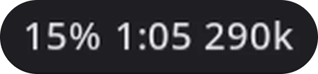
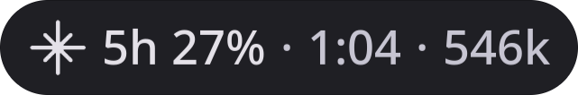
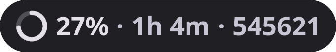
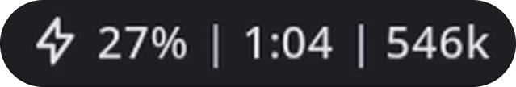
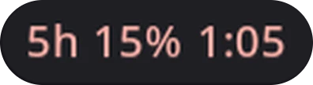

<div align="center">


<br>

[](https://github.com/noctalia-dev/noctalia)
[](https://docs.noctalia.dev/noctalia/plugins/development/)
[](https://github.com/YaLTeR/niri)
[](LICENSE)

**See how much of your Claude Code limit is left — right in your bar.**

[Quick start](#-quick-start) · [Examples](#-examples) · [Customize](#-customize) · [Privacy](#-privacy)

</div>

---

## 🚀 Quick start

1. In Noctalia open **Settings → Plugins → Add source**, choose **git** and paste
   `https://github.com/Seo1323/noctalia-claude-usage`.
2. Switch on **Claude Limits** in the plugin list.
3. Add the **Claude Limits** widget to your bar.

You need `curl`, `jq` and Claude Code logged in on this machine.

<details>
<summary>Prefer the terminal?</summary>

```sh
noctalia msg plugins source add seo git https://github.com/Seo1323/noctalia-claude-usage
noctalia msg plugins enable seo/claude-usage
```

</details>

## ✨ What you get

- **Your limits at a glance** — 5-hour and weekly usage, time to reset and tokens used.
- **Text, bar or ring** — numbers, a small progress bar, or a ring that empties as you go.
- **Quiet when you want** — show details always, only when usage is high, or on hover.
- **A panel on click** — both limits, token graphs, tokens per model and a Claude Code launcher.
- **Make it yours** — 40+ options for icons, formats, colors and layout.
- **Speaks your language** — all 29 languages Noctalia supports.

## 📸 Examples

<table>
  <tr>
    <td align="center"><br><sub><b>Default</b></sub></td>
    <td align="center"><br><sub><b>Plain text</b></sub></td>
  </tr>
  <tr>
    <td align="center"><br><sub><b>Star icon + label</b></sub></td>
    <td align="center"><br><sub><b>Both windows</b></sub></td>
  </tr>
  <tr>
    <td align="center"><br><sub><b>Progress bar, percent left</b></sub></td>
    <td align="center"><br><sub><b>Verbose and bold</b></sub></td>
  </tr>
  <tr>
    <td align="center"><br><sub><b>Ring only, details on hover</b></sub></td>
    <td align="center"><br><sub><b>Quiet until usage is high</b></sub></td>
  </tr>
  <tr>
    <td align="center"><br><sub><b>Any glyph, bar separators</b></sub></td>
    <td align="center"><br><sub><b>Critical color</b></sub></td>
  </tr>
</table>

<details>
<summary>Settings behind each example</summary>

| Example | Settings |
| --- | --- |
| Default | nothing changed |
| Plain text | `logo = none`, `separator = none`, `dim_extras = false` |
| Star icon + label | `logo = star`, `show_prefix = true` |
| Both windows | `logo = glyph`, `window = both`, `show_reset = false`, `show_tokens = false` |
| Progress bar, percent left | `show_bar = true`, `percent_mode = left`, `show_tokens = false` |
| Verbose and bold | `reset_format = verbose`, `token_format = full`, `font_weight = bold` |
| Ring only, details on hover | `display_mode = hover`, `logo = ring` |
| Quiet until usage is high | `display_mode = important` |
| Any glyph, bar separators | `logo = glyph`, `glyph = bolt`, `separator = bar` |
| Critical color | above `critical_at` (forced here with `critical_at = 5`) |

</details>

## 🎨 Customize

Middle-click the widget, or open it in **Settings → Bar**. Less common options are
behind Noctalia's **Advanced** switch, and options that do not apply (for example ring thickness without the ring)
stay hidden.

| What | Options |
| --- | --- |
| **Content** | 5-hour, weekly or both windows · usage used or left · progress bar · time to reset · tokens · current model · cost at API prices |
| **Icon** | none · any glyph · bundled star · your own SVG/PNG · usage ring (thin / normal / thick) · size |
| **When to show details** | always · only above the warning threshold · on hover, with an adjustable animation |
| **Format** | `1:05` or `1h 5m` · `290k` or `289731` · 0–2 decimals · separators · custom `5h` / `7d` labels · your own text template |
| **Look** | spacing · font size and weight · dimmed time and tokens · hide while usage is low |
| **Colors** | by usage or a smooth gradient · warning / critical thresholds and colors · own color for the weekly window |
| **Panel** | centered or attached to the bar · translucent background · Claude Code launch command |
| **Alerts and clicks** | notification at the thresholds · left click: panel, command or refresh · right click: refresh |
| **Cost** | 20 currencies with daily ECB rates or a manual rate |

The full list with defaults is on the [plugin page](claude-usage/README.md#settings).

## 🔒 Privacy

- One request per refresh to `api.anthropic.com`, using the token Claude Code already stores. The token is only read.
- Token counts come from your local Claude Code transcripts; nothing about them is sent anywhere.
- Only when costs are shown in a currency other than USD, the daily exchange rates are fetched from the European
  Central Bank.

<details>
<summary>Languages, related plugins and the fine print</summary>

### Languages

The widget follows Noctalia's language (**Settings → Appearance → Language**). English and Polish are maintained by
the author; the other 27 were machine-translated — fixes to [`claude-usage/translations`](claude-usage/translations)
are very welcome.

### See also

[**Claude Code Usage**](https://github.com/noctalia-dev/community-plugins/tree/main/claudecode) (`jrohland/claudecode`)
is another Noctalia plugin for Claude Code usage, with a richer dashboard (costs, activity charts, profiles). Claude
Limits was written independently and goes another way:

- **Highly configurable, made to fit your bar** — nearly every part can be switched on or off and restyled.
- **Small by default** — one compact capsule; details on demand.
- **Lightweight** — a shell script with `curl` + `jq`, no Python; one request per refresh for every bar and monitor.
- **Quick launcher** — the panel starts Claude Code with a chosen model and session mode.

### Notes

Costs are estimates at Anthropic API list prices — with a Claude subscription you do not pay per token. The plugin
uses an undocumented usage endpoint that may change. Not affiliated with or endorsed by Anthropic.

</details>

## 📄 License

[MIT](LICENSE)
