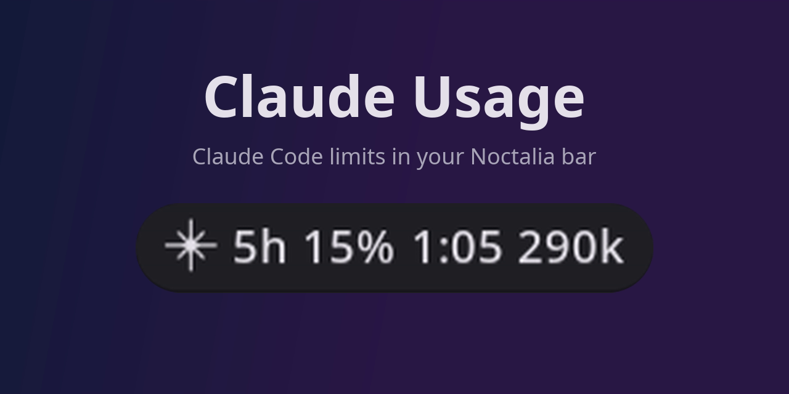
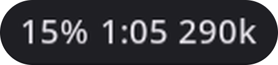
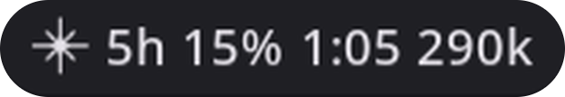
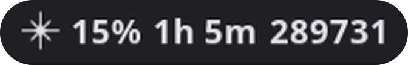

<div align="center">



<br>

[](https://github.com/noctalia-dev/noctalia)
[](https://docs.noctalia.dev/noctalia/plugins/development/)
[](https://github.com/YaLTeR/niri)
[](LICENSE)

**See how much of your Claude Code limit is left — without leaving your desktop.**

[Install](#-install) · [Examples](#-examples) · [Settings](#%EF%B8%8F-settings) · [How it works](#-how-it-works)

</div>

---

## ✨ Features

- **5-hour and weekly limits** — usage percentage straight from your Claude account.
- **Time to reset** — a live countdown (`1:05` or `1h 5m`), or `ready` when no window is running.
- **Tokens used** — counted locally from your Claude Code transcripts (`290k` or `289731`).
- **Colors that warn you** — switches to warning / critical colors above the thresholds you pick.
- **Make it yours** — choose what is shown, the icon (none, glyph, bundled star or your own image), spacing, font weight and colors.
- **Light on resources** — one background poller, no matter how many monitors or bars.

## 📸 Examples

Same widget, different settings:

<table>
  <tr>
    <td align="center"></td>
    <td><b>Defaults</b><br>usage · time to reset · tokens</td>
  </tr>
  <tr>
    <td align="center"></td>
    <td><b>Star icon + label</b><br><code>logo = star</code>, <code>show_prefix = true</code></td>
  </tr>
  <tr>
    <td align="center"></td>
    <td><b>Both windows, compact</b><br><code>logo = glyph</code>, <code>window = both</code>, <code>show_reset = false</code>, <code>show_tokens = false</code></td>
  </tr>
  <tr>
    <td align="center"></td>
    <td><b>Verbose & bold</b><br><code>reset_format = verbose</code>, <code>token_format = full</code>, <code>font_weight = bold</code></td>
  </tr>
  <tr>
    <td align="center"></td>
    <td><b>Critical color</b><br>shown above <code>critical_at</code> (here forced with <code>critical_at = 5</code>)</td>
  </tr>
</table>

## 🚀 Install

**From Noctalia's settings**

1. Open **Settings → Plugins → Add source**.
2. Choose **git** and paste `https://github.com/Seo1323/noctalia-claude-usage`.
3. Switch on **Claude Usage** in the plugin list.
4. Add the **Claude Usage** widget to your bar.

<details>
<summary><b>Or from a terminal</b></summary>

```sh
noctalia msg plugins source add seo git https://github.com/Seo1323/noctalia-claude-usage
noctalia msg plugins enable seo/claude-usage
```

Then add the **Claude Usage** widget to your bar in Noctalia's settings.

</details>

**Requirements:** Noctalia (plugin API 43+), `curl`, `jq`, and Claude Code logged in on this machine.

## ⚙️ Settings

Everything is set per widget in Noctalia's widget settings. The full list with types and defaults is in the
[plugin page](claude-usage/README.md#settings).

| Group | What you can change |
| --- | --- |
| **Content** | Limit window (5h / weekly / both), usage %, `5h` / `7d` labels, time to reset, tokens |
| **Format** | Reset time `1:05` or `1h 5m`, the text shown when ready, tokens `290k` or `289731` |
| **Look** | Icon (none, glyph, bundled star, custom image), spacing, font weight |
| **Colors** | Color by usage, warning / critical thresholds, text / warning / critical colors |
| **Behaviour** | Refresh interval, custom click command (default: refresh now) |

### Custom icon

Put any SVG or PNG somewhere on disk, set **Icon** to *Custom image* and point **Custom logo path** at it
(or drop it in the plugin folder as `logo.svg`). Light, single-color images blend best with the other bar icons.

## 🔍 How it works

- `fetch.sh` reads the OAuth token Claude Code already stores in `~/.claude/.credentials.json` and asks
  `api.anthropic.com/api/oauth/usage` for utilization and reset times. It never writes or refreshes the token.
- Token counts come from your local transcripts in `~/.claude/projects` (input + output + cache-creation
  tokens, deduplicated per message, inside the current window).
- That one request is the only network call. Nothing else leaves your machine.

If the token has expired, the tooltip says so — use Claude Code once and it refreshes.

## 📄 License

[MIT](LICENSE). Not affiliated with or endorsed by Anthropic. Uses an undocumented usage endpoint that may change.
