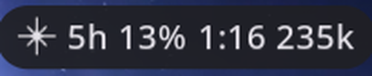
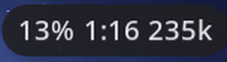
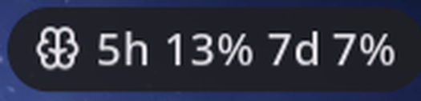
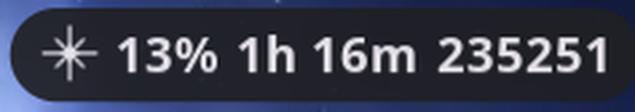
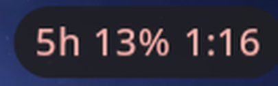

# Claude Usage — Noctalia plugin

Shows your **Claude Code** usage limits in the [Noctalia](https://github.com/noctalia-dev) bar:

<p align="center"></p>

Left to right: usage of the 5-hour window · time to reset · tokens used in that window (shown with the bundled `star` icon). The weekly (7d) window
can be shown too. Hover for a tooltip with both windows, click to refresh.

## Examples

Every item below is the same widget with different settings.

| Look | Settings |
| --- | --- |
|  | Defaults: no icon, usage %, time to reset, tokens. |
|  | `logo = star`, `show_prefix = true` |
|  | `logo = glyph`, `show_prefix = true`, `window = both`, `show_reset = false`, `show_tokens = false` |
|  | `logo = star`, `reset_format = verbose`, `token_format = full`, `font_weight = bold` |
|  | `show_prefix = true`, `show_tokens = false`, `critical_at = 5` (forces the critical color to show it) |

## Requirements

- Noctalia (plugin API 43+)
- `curl` and `jq`
- Claude Code logged in (`~/.claude/.credentials.json`, or `$CLAUDE_CONFIG_DIR`)

## How it works

- `fetch.sh` reads the OAuth token Claude Code already stores (it never writes or refreshes it)
  and queries `https://api.anthropic.com/api/oauth/usage` for the utilization and reset times.
- Token counts are computed locally from Claude Code's transcripts in `~/.claude/projects`
  (input + output + cache-creation tokens, deduplicated per message, inside the current window).
- A single background service polls the API, so several monitors still cost one request.
- Nothing is sent anywhere except that one request to the Anthropic API.

If the token has expired, the widget says so — just use Claude Code once to refresh it.

## Install

```sh
git clone https://github.com/Seo1323/noctalia-claude-usage ~/noctalia-plugins/claude-usage
noctalia msg plugins source add local ~/noctalia-plugins   # once, if not added yet
noctalia msg plugins enable seo/claude-usage
```

Then add the **Claude Usage** widget to your bar in Noctalia's settings.

## Widgets

| Widget | Description |
| --- | --- |
| `bar` | Text capsule: usage %, time to reset, tokens. |
| `icon` | Compact variant: only an icon, usage in the tooltip; click launches a command. |

## Settings

Global: `refresh_minutes` (default 5).

`bar` widget:

| Setting | Default | Description |
| --- | --- | --- |
| `window` | `five_hour` | `five_hour`, `weekly` or `both`. |
| `logo` | `none` | `none`, `glyph` (built-in brain icon), `star` (bundled `assets/star.svg`) or `custom` (your own image). |
| `logo_path` | empty | Image used when `logo` = `custom`; empty = `logo.svg` in the plugin folder (advanced). |
| `show_percent` | `true` | Usage percentage. |
| `show_prefix` | `false` | `5h` / `7d` label before the percentage. |
| `show_reset` | `true` | Time left until the window resets. |
| `reset_format` | `compact` | `compact` (`1:37`) or `verbose` (`1h 37m`). |
| `ready_text` | `ready` | Shown instead of a countdown when no reset is pending. |
| `show_tokens` | `true` | Tokens used in the window. |
| `token_format` | `short` | `short` (`141k`) or `full` (`141234`). |
| `gap` | `4` | Spacing between items (px). |
| `font_weight` | `medium` | `medium` or `bold`. |
| `color_by_usage` | `true` | Use warning / critical colors above the thresholds. |
| `warn_at` / `critical_at` | `70` / `90` | Thresholds in %. |
| `color` / `warn_color` / `critical_color` | `on_surface` / `tertiary` / `error` | Color roles or hex colors (advanced). |
| `click_command` | empty | Shell command on click; empty = refresh now (advanced). |

`icon` widget: `logo` (`glyph` default, `star` or `custom`), `size` (px) and `command` (default `alacritty -e claude`).

### Custom logo

The repository does not ship the Claude logo (it is Anthropic's trademark). To use one, put your own
SVG/PNG at `claude-usage/logo.svg` (git-ignored) — or anywhere you like and point the **Custom logo path** setting at it — then set the widget's **Icon** setting to *Custom*. Use a light, single-color image so it matches the other bar icons.

## Notes

- Uses an undocumented Anthropic OAuth usage endpoint, which may change without notice.
- Not affiliated with or endorsed by Anthropic.

## License

MIT
