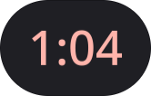

# Claude Limits

<p align="center"></p>

Shows your Claude Code usage in the bar: how much of the 5-hour (and optionally weekly) limit is used, how long
until it resets, and how many tokens you used in that window — as text, a small progress bar or a usage ring.
Details can stay visible, appear only when usage is high, or appear only on hover. Click to refresh.

## Plugin

| Field | Value |
| --- | --- |
| ID | `seo/claude-usage` |
| Entries | Bar widget: `bar`; bar widget: `icon`; panel: `panel`; service: `poller` |

## Requirements

Install `curl` and `jq` on `PATH`. Claude Code must be logged in on this machine
(`~/.claude/.credentials.json`, or `$CLAUDE_CONFIG_DIR/.credentials.json`).

## Usage

Add **Claude Limits** to a bar in **Settings → Bar** and pick the entry:

- **`bar`** — capsule with an optional icon or usage ring, usage %, progress bar, time to reset and tokens.
  With **Show details** set to *Only on hover* it shrinks to the icon or ring until you point at it. Left click
  runs your `click_command` (for example `alacritty -e claude`) or refreshes when it is empty; right click
  always refreshes.
- **`icon`** — compact variant: only an icon or a usage ring, everything else in the tooltip. Click runs
  `command` (default `alacritty -e claude`).

- **`panel`** — opens on a left click on the `bar` widget (default `click_action`), or with
  `noctalia msg panel-toggle seo/claude-usage:panel`. It shows both limits, lets you start Claude Code in a
  terminal with a chosen model (default, Opus, Sonnet, Haiku) and mode (new session, `--continue`, `--resume`),
  resumes one of your 3 latest sessions with one click (in the folder where it was started, so `--resume` finds it),
  graphs your tokens over the last 24 hours and 7 days (hover a graph for the value), and lists tokens per model
  for the 5-hour or weekly window. It opens in the middle of the screen like the built-in panels; Noctalia's own
  panel settings (**Settings → Plugins**, gear on the plugin) switch it to attached, another position or "open near
  the widget". Its background can be made translucent from the `bar` widget settings.

The `poller` service starts with the plugin and refreshes every `refresh_minutes`; all widgets share its result.

### Examples

| Look | How |
| --- | --- |
|  | **Default** — nothing changed |
|  | **Plain text** — Picture in front: None · Separator: None · Make the time and tokens dimmer: off |
|  | **Star icon + label** — Picture in front: Star · Show which limit it is: on |
|  | **Both windows** — Picture in front: Icon · Which limit to show: Both · Show time until the limit refills: off · Show tokens used: off |
|  | **Verbose and bold** — Time format: Long · Token number style: Exact · Text weight: Bold |
|  | **Critical color** — usage above “Critical from (%)” (set to 5 here to show it) |
|  | **Progress bar, percent left** — Show a progress bar: on · Show the percentage as: Left · Show tokens used: off |
|  | **Ring only, details on hover** — When to show the details: Only when I point at it |
|  | **Quiet until usage is high** — When to show the details: Only when usage is high |
|  | **Any glyph** — Picture in front: Icon · Which icon: bolt · Separator: Bar |
|  | **Limit used up** — nothing changed; at 100% only the countdown is shown |

## Settings

Middle-click the widget (or open it in **Settings → Bar**) to change these. Settings marked ⚙ appear when
Noctalia's **Advanced** switch is on, and settings that do not apply right now stay hidden.

### For every widget (Settings → Plugins → gear next to Claude Limits)

| Setting | Default | What it does |
| --- | --- | --- |
| How often to check (minutes) | `5` | How often the widget asks for your latest usage. |
| Decimals in percentages ⚙ | `0` | 0 shows whole numbers. Usage currently comes in whole percents, so decimals usually show .0. |
| Command that opens Claude Code | `alacritty -e claude` | The panel uses it to open Claude Code in a terminal. The model and session you pick are added at the end. |
| Currency | USD ($) | Costs are converted from US dollars with the European Central Bank's daily rates, or with your own rate. Choices: USD ($), EUR (€), PLN (zł), GBP (£), CHF, JPY (¥), CNY (¥), CAD (C$), AUD (A$), SEK (kr), NOK (kr), DKK (kr), CZK (Kč), HUF (Ft), RON (lei), TRY (₺), BRL (R$), INR (₹), KRW (₩), MXN (MX$). |
| My exchange rate ⚙ | `0.0` | How much of your currency 1 US dollar is worth. 0 = use the daily rate automatically. |
| Use my own token prices ⚙ | off | Replace Anthropic's price list with your own prices, for every model. |
| Price of text sent to Claude | `4.0` | In US dollars per million tokens. Saving text for re-reading costs 1.25× or 2× this. |
| Price of text Claude writes | `20.0` | In US dollars per million tokens. |
| Price of re-read text | `0.2` | In US dollars per million tokens. |

Noctalia adds its own panel settings on the same page: where the panel opens (centered by default) and whether it
is attached to the bar.

### `bar` widget

#### What is shown

| Setting | Default | What it does |
| --- | --- | --- |
| Which limit to show | 5-hour limit | Claude Code has a 5-hour limit and a weekly limit. Show one of them or both. Choices: 5-hour limit, Weekly limit (7d), Both. |
| Show the percentage | on |  |
| Show the percentage as | Used (22%) | Choices: Used (22%), Left (78% left). |
| Show which limit it is | off | Puts a short name such as “5h” or “7d” before each percentage. |
| Name of the 5-hour limit ⚙ | `5h` |  |
| Name of the weekly limit ⚙ | `7d` |  |
| Show a progress bar | off | A small bar next to the percentage. |
| Progress bar width (px) ⚙ | `32` |  |
| The bar and ring show ⚙ | What is left | Choose whether they fill up with what you have left or with what you have used. Choices: What is left, What is used. |
| Show time until the limit refills | on | A countdown to the moment your limit is full again. |
| Time format | Short (1:44) | Choices: Short (1:44), Long (1h 44m). |
| Text when the limit is full ⚙ | empty | Shown instead of the countdown when you have not used this limit yet. Leave empty for “ready”. |
| Show tokens used | on | Tokens are pieces of text Claude reads and writes. Counted on your own computer. |
| Also count re-read text ⚙ | off | Claude re-reads the conversation before every answer. Counting that makes the number much bigger. |
| Token number style ⚙ | Short (92k) | Choices: Short (92k), Exact (92424). |
| Show what it would cost | off | An estimate of what this usage would cost if you paid per token. With a Claude subscription you do not pay this. |
| Show the current model | off | The Claude model you used last, for example Opus 5.5. |
| My own text ⚙ | empty | Write your own text instead of the usual items. Words in braces are filled in: {window} {pct} {left} {reset} {tokens} {cost} {model}. Example: {pct} · {reset}. Leave empty for the normal look. |

#### Picture in front

| Setting | Default | What it does |
| --- | --- | --- |
| Picture in front | Usage ring | Shown before the numbers. The ring is a small circle that fills up as you use the limit. Choices: None, Icon, Star, My own picture, Usage ring. |
| Which icon | `brain` |  |
| My picture | empty | An SVG or PNG file. Leave empty to use logo.svg from the plugin folder. |
| Picture size (px) | `18` |  |
| Ring thickness | Normal | Choices: Thin, Normal, Thick. |
| Show the ring's background ⚙ | on | A faint full circle behind the filled part. |

#### When details show

| Setting | Default | What it does |
| --- | --- | --- |
| When to show the details | Always | The details are the time until the limit refills, the tokens and the bar. Choices: Always, Only when usage is high, Only when I point at it. |
| Animation speed (ms) | `250` | How long the details take to slide in when you point at the widget. 0 = no animation. |
| When a limit runs out, show only the countdown | on | At 100% the widget shows just the time until you can use Claude Code again. |
| Hide until usage reaches (%) ⚙ | `0` | Keeps the widget out of sight while usage is low. 0 = always visible. |

#### Look

| Setting | Default | What it does |
| --- | --- | --- |
| Separator | Dot (·) | Choices: None, Dot (·), Bar (\|), Slash (/). |
| Make the time and tokens dimmer | on | Only the percentage keeps the warning colors. |
| Space between items (px) ⚙ | `4` |  |
| Text size (px) ⚙ | `0` | 0 = the same size as the rest of the bar. |
| Text weight ⚙ | Medium | Choices: Medium, Bold. |

#### Colors

| Setting | Default | What it does |
| --- | --- | --- |
| Change color as usage grows | on | Turns to the warning color, then the critical color, at the levels below. |
| Smooth color change | off | The color shifts little by little as usage grows instead of jumping at the levels. |
| Warning from (%) | `70` |  |
| Critical from (%) | `90` |  |
| Normal text color ⚙ | `on_surface` | Pick a color from your theme or any color you like. |
| Warning color ⚙ | `tertiary` |  |
| Critical color ⚙ | `error` |  |
| Different color for the weekly limit ⚙ | off | Used when both limits are shown. |
| Weekly limit color ⚙ | `secondary` |  |

#### Clicks, panel and notifications

| Setting | Default | What it does |
| --- | --- | --- |
| Left click does | Open the panel | What happens when you left-click the widget. A right click always refreshes. Choices: Open the panel, Runs my command, Refresh. |
| My command | empty | A command to run, for example alacritty -e claude to open Claude Code in a terminal. |
| See-through panel | off | Lets your wallpaper show through the panel. The text stays sharp. |
| How solid the panel is | `0.85` | 0 = fully see-through, 1 = solid. |
| Show “Resume a session” in the panel | on | Buttons that reopen one of your latest Claude Code conversations. |
| Notifications | Off | Get one notification when usage passes a level. Choices: Off, At the warning and critical levels, Only at the critical level. |

### `icon` widget

| Setting | Default | What it does |
| --- | --- | --- |
| Picture in front | Icon | Shown before the numbers. The ring is a small circle that fills up as you use the limit. Choices: Icon, Star, My own picture, Usage ring. |
| Which icon | `brain` |  |
| My picture | empty | An SVG or PNG file. Leave empty to use logo.svg from the plugin folder. |
| Icon size (px) | `20` |  |
| Command on click | `alacritty -e claude` | A command to run when you click the icon, for example alacritty -e claude. |

## Languages

The settings window, the tooltip and the bar text follow Noctalia's language (**Settings → Appearance → Language**,
`[shell] lang`). Translations ship for every language Noctalia supports: `ar`, `be`, `be-Latn`, `ca`, `cs`, `de`,
`en`, `en-GB`, `es`, `fr`, `gl-ES`, `he`, `hu`, `it`, `ja`, `ko`, `ku`, `nl`, `nn`, `pl`, `pt-BR`, `ro`, `ru`, `sv`,
`tr`, `uk-UA`, `vi`, `zh-Hans` and `zh-Hant`.

English and Polish are maintained by the author; the others were machine-translated, then checked for plain wording,
gender-neutral phrasing, spelling and grammar, but not yet reviewed by native speakers. Corrections are very welcome — edit `translations/<lang>.json` and open a pull request.

## IPC

Toggle the panel:

```sh
noctalia msg panel-toggle seo/claude-usage:panel
```

Refresh immediately:

```sh
noctalia msg plugin seo/claude-usage:poller all refresh
```

## See also

[**Claude Code Usage**](https://github.com/noctalia-dev/community-plugins/tree/main/claudecode) (`jrohland/claudecode`)
is another Noctalia plugin for Claude Code usage, with a richer dashboard (costs, activity charts, profiles). Claude
Limits was written independently and takes a different direction:

- **Highly configurable, made to fit your bar** — almost every part can be switched on or off and
  restyled: icon (none, any glyph, bundled star, your own image or a usage ring), percent used or left with 0–2
  decimals, progress bar, time format, token format, separators, dimmed extras, spacing, font weight and colors.
- **Small by default** — one compact capsule; details can stay visible, appear only when usage is high, or slide
  out on hover with an adjustable animation.
- **Lightweight** — a shell script with `curl` + `jq`, no Python; one request per refresh for every bar and monitor.
- **Quick launcher** — the click panel starts Claude Code with a chosen model and session mode.

## Notes

- **Network:** one HTTPS request per refresh to `https://api.anthropic.com/api/oauth/usage`, authenticated with
  the OAuth token Claude Code stores in `~/.claude/.credentials.json`. The token is only read, never written or
  refreshed. If it has expired, the tooltip says so; using Claude Code once refreshes it.
- **Exchange rates:** only when `currency` is not USD and `exchange_rate` is 0, the poller runs `rates.sh`, which
  fetches the ECB daily reference rates from `https://www.ecb.europa.eu` at most every 12 hours.
- **Cache:** the last good reading is kept in the plugin data directory (`last.json`), so a restart or a rate limit
  shows stale numbers instead of an empty widget.
- **Cost estimates:** prices per model are built into `shared.luau` (Anthropic API list prices, November 2026;
  cache writes at 1.25x input for the 5-minute TTL and 2x for the 1-hour TTL). With a Claude subscription you do not
  pay per token - the figure shows what the same usage would cost on the API. Unknown models fall back to their
  family's price.
- **Panel data:** the graphs, the per-model table and the recent-session buttons (folder, time and the first ~60
  characters of the first prompt) come from the same local transcripts; nothing extra is sent.
- **Files read:** `~/.claude/.credentials.json` and transcripts in `~/.claude/projects/**/*.jsonl` modified in the
  last 8 days (to count tokens: input + output + cache-creation, deduplicated per message; cache reads are
  counted separately and added only with `include_cache_read`).
- **Processes:** the poller runs `fetch.sh` directly (no shell), which runs `curl`, `jq`, `find`, `xargs` and
  `grep`. Clicking the `bar` widget refreshes through the plugin's shared state without spawning anything, unless
  you set `click_command`; the `icon` widget runs `command`.
- **Files written:** the usage ring is drawn as small SVG files cached in the plugin's data directory
  (`noctalia.pluginDataDir()`), one per percentage and color. `ui.ring` would avoid this but needs plugin API 55.
- Uses an undocumented endpoint that may change without notice. Not affiliated with or endorsed by Anthropic.
