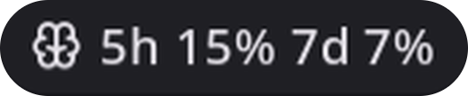
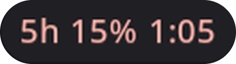

# Claude Usage

<p align="center"></p>

Shows your Claude Code usage in the bar: how much of the 5-hour (and optionally weekly) limit is used, how long
until it resets, and how many tokens you used in that window. Hover for both windows, click to refresh.

## Plugin

| Field | Value |
| --- | --- |
| ID | `seo/claude-usage` |
| Entries | Bar widget: `bar`; bar widget: `icon`; service: `poller` |

## Requirements

Install `curl` and `jq` on `PATH`. Claude Code must be logged in on this machine
(`~/.claude/.credentials.json`, or `$CLAUDE_CONFIG_DIR/.credentials.json`).

## Usage

Add **Claude Usage** to a bar in **Settings → Bar** and pick the entry:

- **`bar`** — text capsule: usage %, time to reset and tokens. Click refreshes now (or runs your
  `click_command`).
- **`icon`** — compact variant: only an icon, everything else in the tooltip. Click runs `command`
  (default `alacritty -e claude`).

The `poller` service starts with the plugin and refreshes every `refresh_minutes`; all widgets share its result.

### Examples

| Look | Settings |
| --- | --- |
|  | Defaults |
|  | `logo = star`, `show_prefix = true` |
|  | `logo = glyph`, `show_prefix = true`, `window = both`, `show_reset = false`, `show_tokens = false` |
|  | `logo = star`, `reset_format = verbose`, `token_format = full`, `font_weight = bold` |
|  | `show_prefix = true`, `show_tokens = false`, `critical_at = 5` |

## Settings

Plugin:

| Setting | Type | Default | Description |
| --- | --- | --- | --- |
| `refresh_minutes` | `int` | `5` | How often the usage API is queried (1–120 minutes). |

`bar` widget:

| Setting | Type | Default | Description |
| --- | --- | --- | --- |
| `window` | `select` | `five_hour` | Which limit to show: `five_hour`, `weekly` or `both`. |
| `logo` | `select` | `none` | `none`, `glyph` (built-in brain icon), `star` (bundled `assets/star.svg`) or `custom`. |
| `logo_path` | `string` | `""` | Image for `custom`; empty means `logo.svg` in the plugin folder. `~` is expanded. |
| `show_percent` | `bool` | `true` | Show the usage percentage. |
| `show_prefix` | `bool` | `false` | Prefix the percentage with `5h` / `7d`. |
| `show_reset` | `bool` | `true` | Show the time left until the window resets. |
| `reset_format` | `select` | `compact` | `compact` (`1:05`, hours:minutes) or `verbose` (`1h 5m`). |
| `ready_text` | `string` | `ready` | Shown instead of the countdown when no window is running. |
| `show_tokens` | `bool` | `true` | Show tokens used in the window. |
| `include_cache_read` | `bool` | `false` | Add prompt-cache reads to the token count. They are cheap but numerous, so the number gets much larger. The tooltip always shows them separately. |
| `token_format` | `select` | `short` | `short` (`290k`) or `full` (`289731`). |
| `gap` | `int` | `4` | Spacing between items, in pixels (0–24). |
| `font_weight` | `select` | `medium` | `medium` or `bold`. |
| `color_by_usage` | `bool` | `true` | Use the warning / critical colors above the thresholds. |
| `warn_at` | `int` | `70` | Warning threshold, in percent. |
| `critical_at` | `int` | `90` | Critical threshold, in percent. |
| `color` | `color` | `on_surface` | Normal text color (color role or hex). |
| `warn_color` | `color` | `tertiary` | Text color above `warn_at`. |
| `critical_color` | `color` | `error` | Text color above `critical_at`. |
| `click_command` | `string` | `""` | Shell command run on click; empty refreshes now. |

`icon` widget:

| Setting | Type | Default | Description |
| --- | --- | --- | --- |
| `logo` | `select` | `glyph` | `glyph`, `star` or `custom`. |
| `logo_path` | `string` | `""` | Image for `custom`; empty means `logo.svg` in the plugin folder. |
| `size` | `int` | `20` | Icon size, in pixels (10–40). |
| `command` | `string` | `alacritty -e claude` | Command run on click. |

## IPC

Refresh immediately:

```sh
noctalia msg plugin seo/claude-usage:poller all refresh
```

## Notes

- **Network:** one HTTPS request per refresh to `https://api.anthropic.com/api/oauth/usage`, authenticated with
  the OAuth token Claude Code stores in `~/.claude/.credentials.json`. The token is only read, never written or
  refreshed. If it has expired, the tooltip says so; using Claude Code once refreshes it.
- **Files read:** `~/.claude/.credentials.json` and transcripts in `~/.claude/projects/**/*.jsonl` modified in the
  last 8 days (to count tokens: input + output + cache-creation, deduplicated per message; cache reads are
  counted separately and added only with `include_cache_read`). Nothing is written.
- **Processes:** `fetch.sh` runs `curl`, `jq`, `find`, `xargs` and `cat`. A click runs `click_command` / `command`
  if you set one.
- Uses an undocumented endpoint that may change without notice. Not affiliated with or endorsed by Anthropic.
