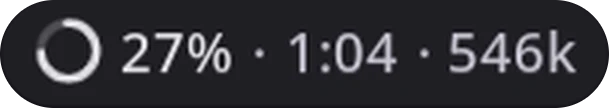
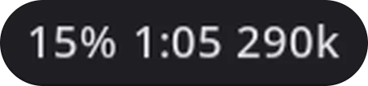
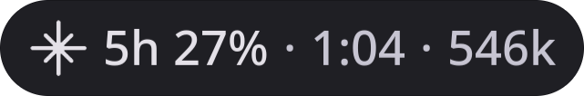
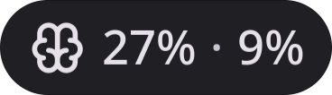
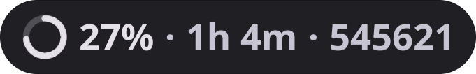
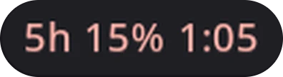
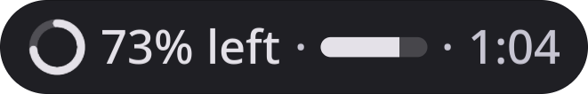
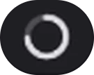
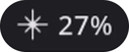
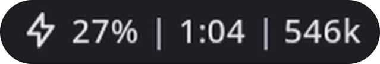

# Claude Limits

<p align="center"></p>

Shows your Claude Code usage in the bar: how much of the 5-hour (and optionally weekly) limit is used, how long
until it resets, and how many tokens you used in that window — as text, a small progress bar or a usage ring.
Details can stay visible, appear only when usage is high, or appear only on hover. Click to refresh.

## Plugin

| Field | Value |
| --- | --- |
| ID | `seo/claude-usage` |
| Entries | Bar widget: `bar`; bar widget: `icon`; panel: `panel`; service: `poller` |

## Requirements

Install `curl` and `jq` on `PATH`. Claude Code must be logged in on this machine
(`~/.claude/.credentials.json`, or `$CLAUDE_CONFIG_DIR/.credentials.json`).

## Usage

Add **Claude Limits** to a bar in **Settings → Bar** and pick the entry:

- **`bar`** — capsule with an optional icon or usage ring, usage %, progress bar, time to reset and tokens.
  With **Show details** set to *Only on hover* it shrinks to the icon or ring until you point at it. Left click
  runs your `click_command` (for example `alacritty -e claude`) or refreshes when it is empty; right click
  always refreshes.
- **`icon`** — compact variant: only an icon or a usage ring, everything else in the tooltip. Click runs
  `command` (default `alacritty -e claude`).

- **`panel`** — opens on a left click on the `bar` widget (default `click_action`), or with
  `noctalia msg panel-toggle seo/claude-usage:panel`. It shows both limits, lets you start Claude Code in a
  terminal with a chosen model (default, Opus, Sonnet, Haiku) and mode (new session, `--continue`, `--resume`),
  graphs your tokens over the last 24 hours and 7 days (hover a graph for the value), and lists tokens per model
  for the 5-hour or weekly window. It opens in the middle of the screen like the built-in panels; Noctalia's own
  panel settings (**Settings → Plugins**, gear on the plugin) switch it to attached, another position or "open near
  the widget". Its background can be made translucent from the `bar` widget settings.

The `poller` service starts with the plugin and refreshes every `refresh_minutes`; all widgets share its result.

### Examples

| Look | Settings |
| --- | --- |
|  | Defaults |
|  | `logo = none`, `separator = none`, `dim_extras = false` |
|  | `logo = star`, `show_prefix = true` |
|  | `logo = glyph`, `show_prefix = true`, `window = both`, `show_reset = false`, `show_tokens = false` |
|  | `logo = star`, `reset_format = verbose`, `token_format = full`, `font_weight = bold` |
|  | `show_prefix = true`, `show_tokens = false`, `critical_at = 5` |
|  | `show_bar = true`, `percent_mode = left`, `show_tokens = false` |
|  | `display_mode = hover`, `logo = ring` (at rest) |
|  | `display_mode = important`, `logo = star` |
|  | `logo = glyph`, `glyph = bolt`, `separator = bar` |

## Settings

Settings marked ⚙ are behind Noctalia's **Advanced** switch. Options that do not apply right now (for example
`ring_thickness` without the ring) are hidden in the settings window.

### Plugin

Set once for every widget, under **Settings → Plugins** (gear on the plugin).

| Setting | Default | Description |
| --- | --- | --- |
| `refresh_minutes` | `5` | How often the usage API is queried. |
| `percent_decimals` ⚙ | `0` | 0 rounds to whole numbers. The API currently reports whole percentages, so decimals usually show .0. |
| `launch_command` | `alacritty -e claude` | Terminal command the panel uses to start Claude Code; the chosen --model and mode are appended. |
| `currency` | `USD` | Costs are converted from USD with the European Central Bank's daily reference rates (fetched at most every 12 hours, only for a currency other than USD), unless you set a manual rate. Options: `USD`, `EUR`, `PLN`, `GBP`, `CHF`, `JPY`, `CNY`, `CAD`, `AUD`, `SEK`, `NOK`, `DKK`, `CZK`, `HUF`, `RON`, `TRY`, `BRL`, `INR`, `KRW`, `MXN`. |
| `exchange_rate` ⚙ | `0.0` | Units of the chosen currency per 1 USD. 0 = use the ECB daily rate. |

Noctalia also adds its standard panel settings there: placement (floating / attached), position (default:
center) and "open near the widget".

### `bar` widget

#### What is shown

| Setting | Default | Description |
| --- | --- | --- |
| `window` | `five_hour` | Which usage window the bar shows. Options: `five_hour`, `weekly`, `both`. |
| `show_percent` | `true` | Show usage percentage |
| `percent_mode` | `used` | Percentage shows Options: `used`, `left`. |
| `show_prefix` | `false` | Prefix each percentage with its window. |
| `label_five` ⚙ | `5h` | Label for the 5-hour window |
| `label_week` ⚙ | `7d` | Label for the weekly window |
| `show_bar` | `false` | A small bar next to the percentage. |
| `bar_width` ⚙ | `32` | Progress bar width (px) |
| `gauge_mode` ⚙ | `left` | What the progress bar and the usage ring fill with. Options: `left`, `used`. |
| `show_reset` | `true` | Time left until the window resets. |
| `reset_format` | `compact` | Reset time format Options: `compact`, `verbose`. |
| `ready_text` ⚙ | `""` | Shown instead of a countdown when the window is not running. Empty = "ready" in your language. |
| `show_tokens` | `true` | Tokens used in the window (input + output + cache creation, from local transcripts). |
| `include_cache_read` ⚙ | `false` | Add tokens read from the prompt cache. They are cheap but numerous, so the number gets much larger. |
| `token_format` ⚙ | `short` | Token format Options: `short`, `full`. |
| `show_cost` | `false` | Estimated cost of the window's tokens at Anthropic API list prices. With a Claude subscription you do not pay per token - this shows what the same usage would cost on the API. |
| `show_model` | `false` | The model of your latest Claude Code message, e.g. Opus 5.5. |
| `format` ⚙ | `""` | Replaces the items with your own text, e.g. {pct} · {reset} · {tokens}. Placeholders: {window} {pct} {left} {reset} {tokens} {cost} {model}. Empty = normal layout. |

#### Icon

| Setting | Default | Description |
| --- | --- | --- |
| `logo` | `ring` | Shown before the text. The ring fills with the remaining (or used) share of the limit. Options: `none`, `glyph`, `star`, `custom`, `ring`. |
| `glyph` | `brain` | Glyph |
| `logo_path` | `""` | SVG or PNG. Empty means logo.svg in the plugin folder. |
| `icon_size` | `18` | Icon size (px) |
| `ring_thickness` | `normal` | Ring thickness Options: `thin`, `normal`, `thick`. |
| `ring_track` ⚙ | `true` | The faint full circle behind the filled part. |

#### When details show

| Setting | Default | Description |
| --- | --- | --- |
| `display_mode` | `always` | When the time to reset, tokens and bar are shown. Options: `always`, `important`, `hover`. |
| `animation_ms` | `250` | How long the details take to slide out and fade in. 0 turns the animation off. |
| `hide_below` ⚙ | `0` | Hide the widget while usage is below this value. 0 = always show. |

#### Look

| Setting | Default | Description |
| --- | --- | --- |
| `separator` | `dot` | Separator between items Options: `none`, `dot`, `bar`, `slash`. |
| `dim_extras` | `true` | Show the time to reset and the tokens in a muted color; only the percentage keeps the usage color. |
| `gap` ⚙ | `4` | Spacing between items (px) |
| `font_size` ⚙ | `0` | 0 = the bar's font size. |
| `font_weight` ⚙ | `medium` | Font weight Options: `medium`, `bold`. |

#### Colors

| Setting | Default | Description |
| --- | --- | --- |
| `color_by_usage` | `true` | Switch to the warning / critical colors above the thresholds. |
| `gradient` | `false` | Blend the colors continuously with usage instead of switching at the thresholds. |
| `warn_at` | `70` | Warning threshold (%) |
| `critical_at` | `90` | Critical threshold (%) |
| `color` ⚙ | `on_surface` | Color role or hex color for normal usage. |
| `warn_color` ⚙ | `tertiary` | Warning color |
| `critical_color` ⚙ | `error` | Critical color |
| `weekly_own_color` ⚙ | `false` | Use a different base color for the 7d items when both windows are shown. |
| `weekly_color` ⚙ | `secondary` | Weekly window color |

#### Clicks, panel and alerts

| Setting | Default | Description |
| --- | --- | --- |
| `click_action` | `panel` | What a left click on the widget does. Right click always refreshes. Options: `panel`, `command`, `refresh`. |
| `click_command` | `""` | Shell command run on left click, e.g. alacritty -e claude. |
| `panel_translucent` | `false` | Let the wallpaper show through the panel background; the text stays fully opaque. |
| `panel_opacity` | `0.85` | 0 is fully transparent, 1 is solid. |
| `notify` | `off` | Show a notification once per window when usage crosses a threshold. Options: `off`, `warning`, `critical`. |

### `icon` widget

| Setting | Default | Description |
| --- | --- | --- |
| `logo` | `glyph` | Shown before the text. The ring fills with the remaining (or used) share of the limit. Options: `glyph`, `star`, `custom`, `ring`. |
| `glyph` | `brain` | Glyph |
| `logo_path` | `""` | SVG or PNG. Empty means logo.svg in the plugin folder. |
| `size` | `20` | Icon size (px) |
| `command` | `alacritty -e claude` | Command run when the icon is clicked. |

## Languages

The settings window, the tooltip and the bar text follow Noctalia's language (**Settings → Appearance → Language**,
`[shell] lang`). Translations ship for every language Noctalia supports: `ar`, `be`, `be-Latn`, `ca`, `cs`, `de`,
`en`, `en-GB`, `es`, `fr`, `gl-ES`, `he`, `hu`, `it`, `ja`, `ko`, `ku`, `nl`, `nn`, `pl`, `pt-BR`, `ro`, `ru`, `sv`,
`tr`, `uk-UA`, `vi`, `zh-Hans` and `zh-Hant`.

English and Polish are maintained by the author; the others were machine-translated and have not been reviewed by
native speakers yet. Corrections are very welcome — edit `translations/<lang>.json` and open a pull request.

## IPC

Toggle the panel:

```sh
noctalia msg panel-toggle seo/claude-usage:panel
```

Refresh immediately:

```sh
noctalia msg plugin seo/claude-usage:poller all refresh
```

## See also

[**Claude Code Usage**](https://github.com/noctalia-dev/community-plugins/tree/main/claudecode) (`jrohland/claudecode`)
is another Noctalia plugin for Claude Code usage, with a richer dashboard (costs, activity charts, profiles). Claude
Limits was written independently and takes a different direction:

- **Highly configurable, made to fit your bar** — almost every part can be switched on or off and
  restyled: icon (none, any glyph, bundled star, your own image or a usage ring), percent used or left with 0–2
  decimals, progress bar, time format, token format, separators, dimmed extras, spacing, font weight and colors.
- **Small by default** — one compact capsule; details can stay visible, appear only when usage is high, or slide
  out on hover with an adjustable animation.
- **Lightweight** — a shell script with `curl` + `jq`, no Python; one request per refresh for every bar and monitor.
- **Quick launcher** — the click panel starts Claude Code with a chosen model and session mode.

## Notes

- **Network:** one HTTPS request per refresh to `https://api.anthropic.com/api/oauth/usage`, authenticated with
  the OAuth token Claude Code stores in `~/.claude/.credentials.json`. The token is only read, never written or
  refreshed. If it has expired, the tooltip says so; using Claude Code once refreshes it.
- **Exchange rates:** only when `currency` is not USD and `exchange_rate` is 0, the poller runs `rates.sh`, which
  fetches the ECB daily reference rates from `https://www.ecb.europa.eu` at most every 12 hours.
- **Cache:** the last good reading is kept in the plugin data directory (`last.json`), so a restart or a rate limit
  shows stale numbers instead of an empty widget.
- **Cost estimates:** prices per model are built into `shared.luau` (Anthropic API list prices, November 2026;
  cache writes at 1.25x input for the 5-minute TTL and 2x for the 1-hour TTL). With a Claude subscription you do not
  pay per token - the figure shows what the same usage would cost on the API. Unknown models fall back to their
  family's price.
- **Panel data:** the graphs and the per-model table come from the same local transcripts; nothing extra is sent.
- **Files read:** `~/.claude/.credentials.json` and transcripts in `~/.claude/projects/**/*.jsonl` modified in the
  last 8 days (to count tokens: input + output + cache-creation, deduplicated per message; cache reads are
  counted separately and added only with `include_cache_read`).
- **Processes:** the poller runs `fetch.sh` directly (no shell), which runs `curl`, `jq`, `find`, `xargs` and
  `grep`. Clicking the `bar` widget refreshes through the plugin's shared state without spawning anything, unless
  you set `click_command`; the `icon` widget runs `command`.
- **Files written:** the usage ring is drawn as small SVG files cached in the plugin's data directory
  (`noctalia.pluginDataDir()`), one per percentage and color. `ui.ring` would avoid this but needs plugin API 55.
- Uses an undocumented endpoint that may change without notice. Not affiliated with or endorsed by Anthropic.
